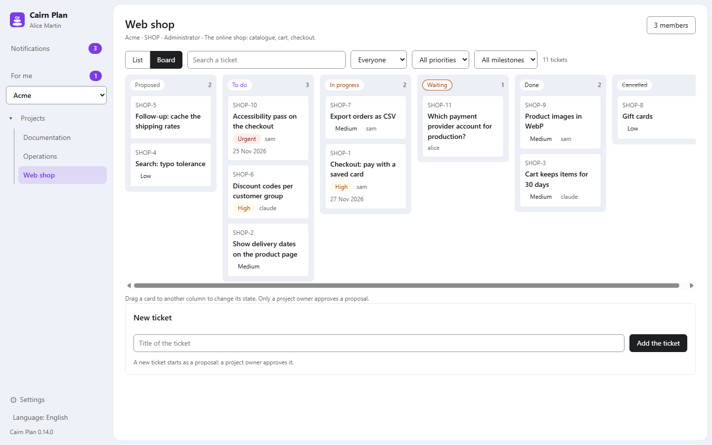
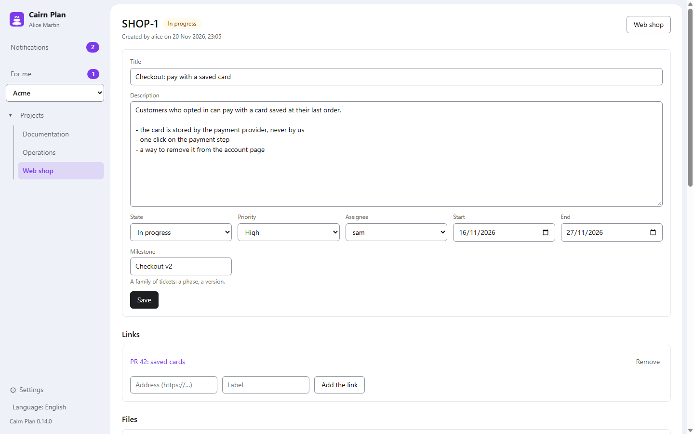
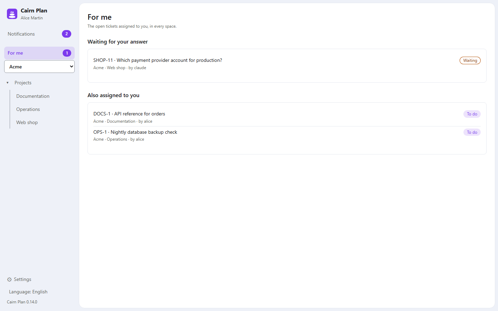
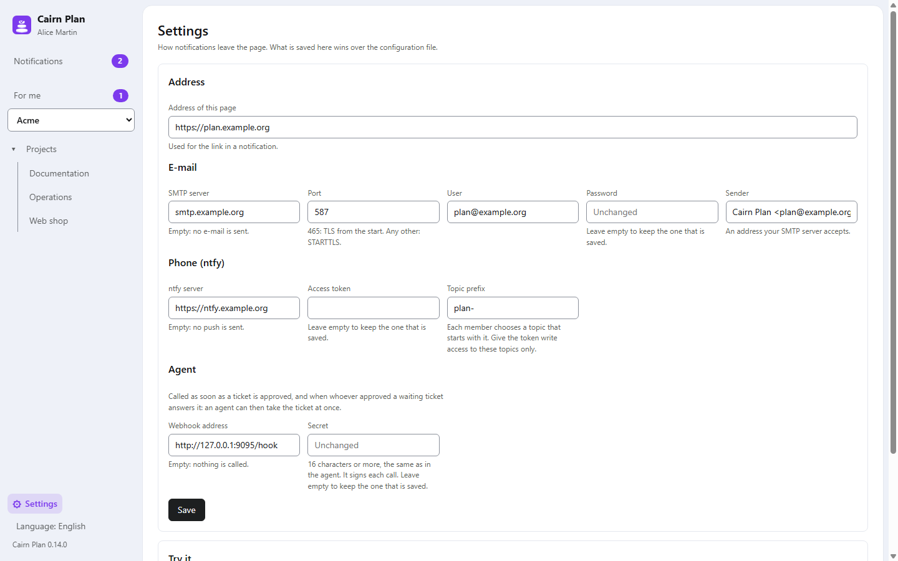
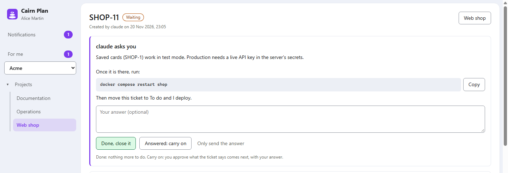

# Cairn Plan

Projects and tickets for a small team: one binary, one SQLite file, no
password of its own.

- **Projects are private.** A person sees only the projects they were added
  to. To anyone else a project does not exist.
- **One space at a time.** A project can be filed under a space (a company,
  an area). You work in one space: the menu and the home page only show its
  projects, and a switch changes space. Rights stay per project.
- **List or board.** The tickets of a project as a table or as one column
  per state, with search and filters; drag a card to change its state.
- **Three roles per project.** A reader reads and comments. A contributor
  creates and edits tickets. An owner approves tickets and manages members.
- **Approval belongs to owners.** A new ticket is a proposal. Only a project
  owner moves it to "To do", and once approved only an owner changes its
  title and description: what was approved is what gets built. The history
  of each ticket says who approved it and when.
- **Sign-in is the proxy's job.** Cairn Plan sits behind an authenticating
  reverse proxy (Traefik + Authelia, for instance) and trusts its identity
  headers, from the proxies you list and nobody else.

A ticket has a title, a description, a state (Proposed, To do, In progress,
Waiting, Done, Cancelled), a priority, an assignee, a start and an end date, links,
files, comments, the time worked on it and a history. The page is in English and French.

## Screenshots

| | |
|---|---|
|  |  |
| Board: one column per state, drag a card to move it. | A ticket: fields, then links, files, time, comments and history. |
|  |  |
| "For me": what is assigned to you, questions first. | Settings: mail, ntfy and the agent, from the page. |



An AI agent asks a project owner something only they can do; the owner answers in one click.

## Run

The image is on GitHub's registry, for `linux/amd64` and `linux/arm64`:

```yaml
# compose.yml
services:
  cairn-plan:
    image: ghcr.io/jbellirigenty/cairn-plan:0.14
    restart: unless-stopped
    read_only: true
    network_mode: host               # listens where config.json says
    volumes:
      - ./config:/etc/cairn-plan:ro
      - ./data:/var/lib/cairn-plan    # owned by uid 65534 (nobody)
```

```sh
mkdir -p config data && chown 65534 data
cat > config/config.json <<'JSON'
{
  "listen": "127.0.0.1:9094",
  "trusted_proxies": ["127.0.0.1"],
  "admin_groups": ["admins"]
}
JSON
docker compose up -d
```

This is for a reverse proxy on the same machine. `trusted_proxies` lists
the addresses your proxy connects from, the only ones whose identity headers are believed (see
[Sign-in](docs/configuration.md#sign-in)). Then set the rest from the
Settings page. Every key: [docs/configuration.md](docs/configuration.md).

To build it yourself: `docker build -t cairn-plan .` (the build runs the
tests).

## For an AI agent

Cairn Plan has an MCP server (`/mcp`). An agent lists the tickets a project
owner approved, takes one, asks its questions in comments, links its pull
request, writes its report and closes the ticket; it can propose a
follow-up, which a person then approves or not. With a key, it works as
one ordinary account, added project by project, that can neither approve
a ticket nor change the text of an approved one. A client that signs
people in through OAuth (claude.ai, Claude Cowork) works as the person
signed in, with their rights. See
[docs/configuration.md](docs/configuration.md#mcp-server).

So that the agent does not have to look for work, Cairn Plan calls a
webhook as soon as a ticket is approved. The folder [agent](agent/) holds a
container that listens to it: it takes the ticket, lets Claude Code work
in a clone of the project's repository, opens a pull request and closes
the ticket with the report. See [agent/README.md](agent/README.md).

## Attached files

A ticket can carry files (a screenshot, a PDF, a log), up to 25 MB each.
See [docs/configuration.md](docs/configuration.md#attached-files).

## Settings

Once the service runs, an administrator sets the rest from the page: the
"Settings" entry of the menu holds the mail server, the ntfy server and
the webhook of the agent, with a button to send a test. See
[docs/configuration.md](docs/configuration.md#settings-page).

## Notifications

Those who take part in a ticket are told when someone else comments it,
changes its state or assigns it to them: in the page, and optionally by
e-mail and ntfy. See
[docs/configuration.md](docs/configuration.md#notifications).

## Pull requests and commits

A Git forge (Forgejo, Gitea, GitHub) can tell Cairn Plan what happens in
its repositories: a pull request or a commit that names a ticket
(`SHOP-51`) is attached to it, and the link says when the pull request is
merged. One webhook to `/hooks/git`, signed with a shared secret. See
[docs/configuration.md](docs/configuration.md#forge-webhooks).

## Import a history

`cairn-plan import <config.json> <draft.json> <space> <login>` creates a
project from a JSON draft of past work: one closed ticket per lot (what was
wanted, what was chosen and why, what was set aside, the result, the
sources), one per decision, one for the open points. Tickets are dated by
the start of their lot and held by `<login>`, who owns the project. A
replay creates nothing twice and leaves what people changed by hand.

```sh
docker exec -i cairn-plan cairn-plan import /etc/cairn-plan/config.json /dev/stdin "My company" me < draft.json
```

## API

The page uses a small JSON API under `/api`, with the same sign-in and the
same rules. Changes are `POST` requests with a JSON body.

| | |
|---|---|
| `GET /api/me` | who you are |
| `GET /api/projects`, `POST /api/projects` | your projects; create one (administrators) |
| `GET /api/projects/KEY`, `POST /api/projects/KEY` | a project, its members and tickets; change `name`, `description`, `space` |
| `POST /api/projects/KEY/members` | `{"login", "role"}`; `"role": null` removes |
| `POST /api/projects/KEY/tickets` | create a ticket |
| `GET /api/tickets/KEY-12`, `POST /api/tickets/KEY-12` | read a ticket; change fields |
| `POST /api/tickets/KEY-12/comments` | `{"body"}` |
| `POST /api/tickets/KEY-12/links` | `{"url", "title"}` or `{"delete": id}` |

## Licence

MIT, see [LICENSE](LICENSE). Security reports: [SECURITY.md](SECURITY.md).

Cairn Plan belongs to the Cairn family of small self-hosted tools, with
[Cairn NAS](https://github.com/JBelliriGenty/Cairn-NAS),
[Cairn Net](https://github.com/JBelliriGenty/Cairn-Net),
[Cairn IaC](https://github.com/JBelliriGenty/Cairn-IaC) and
[Cairn Map](https://github.com/JBelliriGenty/Cairn-Map).
