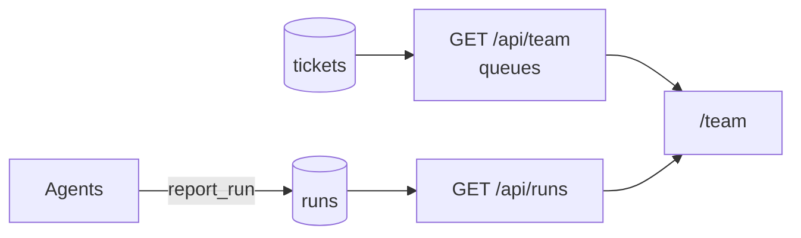

# Configuration reference

Everything Cairn Plan reads, key by key. The [README](../README.md) explains
what it does; this page is what you edit.

Cairn Plan reads one JSON file, given as its first argument
(`/etc/cairn-plan/config.json` in the Docker image), and keeps everything
else in one SQLite file.

```json
{
  "listen": "10.0.0.5:9094",
  "trusted_proxies": ["10.0.0.2"],
  "require_groups": [],
  "admin_groups": ["admins"],
  "db": "/var/lib/cairn-plan/plan.db",
  "lang": "fr"
}
```

| Key | Default | |
|---|---|---|
| `listen` | `127.0.0.1:9094` | Address and port, plain HTTP. TLS is the proxy's job. |
| `trusted_proxies` | none, required | IP addresses of the reverse proxies whose identity headers are believed. A request from any other address is refused (403), whatever its headers. |
| `require_groups` | `[]` | If not empty, only people in one of these groups get in. |
| `admin_groups` | `[]` | People in one of these groups are administrators: they create projects and are owners of every project. |
| `db` | `/var/lib/cairn-plan/plan.db` | The SQLite file. Its folder must be writable by the process (user `nobody` in the image). |
| `lang` | browser's | Default language of the page, `en` or `fr`. Each person can switch. |
| `mcp_keys_file` | none | File of the keys accepted on `/mcp`, one `name:key` per line (key of 32 characters or more; lines starting with `#` are ignored). Without it there is no MCP server (`/mcp` answers 404). |
| `mcp_login` | `claude` | The account MCP calls run as, unless `mcp_accounts` names another for the key. Add it to a project like any member. |
| `mcp_accounts` | `{}` | One account per key, by key name: `{"agent-dev": "claude-dev"}`, for a team of agents where each role has its own account (see the agent's README). Add each account to its project as a contributor: `cairn-plan member <config.json> <KEY> <login>`. |
| `oidc_issuer` | none | OpenID Connect provider (`https://auth.example.org`) whose access tokens are accepted on `/mcp`: a call made with such a token runs as the person signed in (see [Sign-in with OAuth](#sign-in-with-oauth)). Needs `public_url` in the file. |
| `oidc_client_id` | none, required with `oidc_issuer` | The client registered at the provider for MCP clients; a token issued to any other client is refused. |
| `public_url` | none | Address people open Cairn Plan at (`https://plan.example.org`), for the link in a notification. |
| `smtp_host` | none | SMTP server for notifications by e-mail. Without it no e-mail is sent. |
| `smtp_port` | `587` | `465`: TLS from the start; any other port: STARTTLS (required). |
| `smtp_credentials_file` | none | File holding `user:password` on one line, for the SMTP server. |
| `mail_from` | `Cairn Plan <cairn-plan@localhost>` | Sender of the e-mails; an address your SMTP server accepts. |
| `ntfy_url` | none | Address of an ntfy server for push notifications. Without it no push is sent. |
| `ntfy_token_file` | none | File holding an ntfy access token allowed to publish to the topics below. |
| `ntfy_topics` | `{}` | Who gets a push, and on which topic: `{"jane": "plan"}`. Someone who is not listed gets none. |
| `webhook_secrets_file` | none | File of the secrets that may sign a forge webhook, one `name:secret` per line (same format as `mcp_keys_file`). Without it there is no webhook (`/hooks/git` answers 404). |
| `agent_hook_url` | none | Address called when a ticket is approved (see [Agent webhook](#agent-webhook)). Without it nothing is called. |
| `agent_hook_secret_file` | none | File holding the secret that signs those calls, on one line. |
| `team` | none | The members shown on the team page `/team`: see [Team page](#team-page). Without it the page says that no team is configured. |

An unknown key is reported on the first log lines and ignored.

## Settings page

An administrator (someone in one of `admin_groups`) has a "Settings" entry
in the menu. It sets how notifications leave the page: the address of the
page, the SMTP server, the ntfy server; and the webhook of an agent. What
is saved there is kept in the database and wins over the keys `public_url`,
`smtp_*`, `mail_from`, `ntfy_*` and `agent_hook_*` of the file, which stay
useful to prepare an installation. The password, the token and the secret
are never shown again; leaving their field empty keeps what is saved.
"Send a test" sends one message to the administrator (for the agent, one
"ping" call) with the settings that are saved, and shows the answer of the
server if it fails.

The file keeps what is needed before anyone can sign in: `listen`,
`trusted_proxies`, the groups, `db`, and the keys of the MCP server and of
the webhooks.

## Sign-in

Cairn Plan has no password of its own. The reverse proxy signs people in
and passes who they are:

| Header | Use |
|---|---|
| `Remote-User` | the login (lower case letters, digits, `.`, `_`, `-`); it is what you type to add a member to a project |
| `Remote-Groups` | comma-separated groups, matched against `require_groups` and `admin_groups` |
| `Remote-Name`, `Remote-Email` | shown next to the login |

These are the headers Authelia sends through Traefik's `forwardAuth`. Two
things keep them honest: the proxy must overwrite any such header sent by a
browser (Traefik does, with `authResponseHeaders`), and nothing but the
proxy must reach the port (`listen` on a private address, plus a firewall
rule). `trusted_proxies` is the last line: a direct request is refused.

`/healthz` answers `ok` to anyone, for probes.

## MCP server

`/mcp` speaks the Model Context Protocol over HTTP (JSON answers, no
stream) and is the one path that does not go through the proxy's sign-in:
the caller sends `Authorization: Bearer <key>`, a key of `mcp_keys_file`,
or an OAuth access token (below). Route it at the proxy without
`forwardAuth`, with a rate limit, together with
`/.well-known/oauth-protected-resource` and
`/.well-known/oauth-protected-resource/mcp`.

The key only says which client calls (its name is written to the log with
each tool call) and, through `mcp_accounts`, which account it is
(`mcp_login` by default). That account is an ordinary member:
it sees the projects it was added to and, as a contributor, can neither
approve a ticket nor change the text of an approved one. Do not make it
an owner of a project, nor a member of `admin_groups`: it could then
approve its own work.

Tools: `list_projects`, `list_tickets` (approved tickets by default),
`search_tickets` (by a text in the id, title, description or comments),
`get_ticket` (with who approved it, when, and the edits of its text
since), `take_ticket`, `wait_ticket` (a question: the ticket waits),
`comment_ticket`, `add_link`, `finish_ticket` (with the minutes worked),
`propose_ticket`, `ask_owner` (a question to a project owner: a ticket
created "waiting" and assigned to them; it shows first in their « For me »
page, where they answer and move it to "done" or "todo"),
`close_question` (closes a question this account asked with `ask_owner`,
while it still waits: report as a comment, then "done"),
`create_subticket` (splits a ticket this account took into sub-tickets of
the same project, with a role each),
`report_run` (an agent reports a run for the "Agents" page, see below).

### Runs of agents

An agent tells Cairn Plan what it does with `report_run`: once when a run
starts (`state` "running"), again with the same `run_id` when it ends
("ok", "failed" or "waiting"); what the second call leaves out is kept.
Required: `run_id`, `agent`, `source` (a short name in lower case:
`claude-code`, `cairn-plan-agent`), `task` (120 characters at most), `state`,
`started` (seconds since 1970). Optional: `ended`, `host`, `project`,
`ticket` (the project is read from it), `model`, `tokens_in`, `tokens_out`,
`cost_usd` (dollars at the API price), `parent` (the `run_id` that started
it), `result` (60 characters at most: "deployed", "3 gaps").

- Send a summary only: never the instruction given to the agent, nor the
  output of a command. Both may hold a secret.
- An account writes its own runs: the key of a run is the pair (account,
  `run_id`). Another account that sends the same `run_id` writes a run of
  its own and never changes this one.
- A run of a project needs a contributor of that project. Its members see
  it, like its tickets. A run without a project is seen by administrators
  only.
- A run still "running" that sent nothing for 6 hours shows as "No news".
- Read them with `GET /api/runs?since=<date or seconds>&agent=<name>&project=<KEY>`
  (500 newest at most). No setting is needed: the table is created at start.

A sub-ticket created by whoever took its parent starts "todo": the
parent's approval covers it, as long as the parent is in progress, was
approved, and its text was not changed since by someone else. One level,
at most 8 per ticket; its text and role are frozen like any approved
ticket, and cancelling the parent cancels the sub-tickets still open. The
parent shows a progress bar (sub-tickets done out of those not
cancelled).

### Sign-in with OAuth

With `oidc_issuer`, a remote MCP client that signs people in itself
(claude.ai custom connectors, and so Claude Cowork; any client following
the MCP authorization spec) connects without a key, and every call runs
as the person who signed in, with their rights: the projects they are a
member of, their role in each, administrator if they are in
`admin_groups`. Keys keep working as before.

1. At the provider, register a confidential client (`oidc_client_id`)
   with the redirect URIs of the MCP client (for claude.ai:
   `https://claude.ai/api/mcp/auth_callback` and
   `https://claude.com/api/mcp/auth_callback`), grant types
   `authorization_code` and `refresh_token`, PKCE, scopes `openid profile
   email groups offline_access`, and `<public_url>/mcp` as an allowed
   audience (clients send it as the `resource` parameter, RFC 8707).
   Restrict who may use it at the provider if not everyone should.
2. Set `oidc_issuer`, `oidc_client_id` and `public_url`.
3. In the MCP client, add `<public_url>/mcp` with this client id and its
   secret.

Without a valid key, `/mcp` answers 401 with `WWW-Authenticate: Bearer
resource_metadata="<public_url>/.well-known/oauth-protected-resource/mcp"`;
that document (RFC 9728) names `oidc_issuer` as the authorization server,
where the client finds the provider's endpoints. Cairn Plan asks the
provider's `userinfo_endpoint` (from its discovery document) about each
token: the provider vouches that it is genuine and unexpired. The answer
must be meant for Cairn Plan (`aud` lists `oidc_client_id` or
`<public_url>/mcp`, or `azp` is `oidc_client_id`) and carry a
`preferred_username` (the login); `groups` are matched against `require_groups` and `admin_groups`
as on the page, `name` and `email` are shown next to the login. A refused
token is written to the log with the reason, never the token. Written for
Authelia 4.39: its userinfo carries no audience, so `aud` and `client_id`
are read in the access token, a JWT (set `access_token_signed_response_alg:
RS256` on the client), once userinfo has accepted it.

## Currencies and hourly rates

Amounts are shown in one ISO currency. An administrator chooses it in the
"Currencies" block of the Settings page, with what one dollar is worth in
each currency (one line per currency: `EUR 0.92`). The first values are
indicative: adjust them when the rates move. The dollar stays at 1: agents
cost dollars, as Claude Code counts them.

- Each member gives their own hourly rate and its currency in "My profile".
  Only the member, the administrators and the owners of their projects see it.
- The Time page converts each rate to the currency of the page.
- The hourly rate of an agent is computed, not typed: dollars spent by its
  runs over the last 30 days, divided by the time of those runs.
- Nothing is read from the configuration file: the currency and the table
  live in the database (Settings page, or `POST /api/rates`).
- A run that reports no cost takes an estimate from its tokens and a table
  of prices by model (dollars per million tokens: input, output, cache read,
  cache write for one hour). An administrator sets the table in the same
  block of the Settings page; it shows the date of its last change. A model
  that is not in the table has no estimate.

## Team page

`/team` shows the agents (and people) who work on the projects, drawn as
characters. Each member shows its state at a glance (working, waiting for an
answer, resting), its current task and for how long. A click opens its sheet:
on one side what it did (its runs, latest first, with the result of the check
and the cost), on the other side its queue (the open tickets assigned to it,
in the order it will take them). The page reads again every 20 seconds.
"Replay the last 24 hours" plays the runs of the day in one minute. A line
under the title gives the runs of the members since midnight and their cost.



The members come from the `team` key of the configuration file:

```json
"team": {
  "plan_url": "https://plan.example.org",
  "groups": [{"id": "core", "title": "Core team", "note": "workstation"}],
  "members": [
    {"id": "worker", "name": "Worker", "role": "Does the work", "group": "core", "look": "hardhat",
     "hue": "#e0803a", "motto": "I do it. Someone else checks it.", "agents": ["worker"], "assignees": ["bot-worker"]}
  ]
}
```

| Field | Meaning |
|---|---|
| `plan_url` | Address of Cairn Plan, for the links to the tickets when the page is served under another host name. |
| `groups` | Sections of the page, in order: `id`, `title`, optional `note` (shown small next to the title). |
| `id` | Short name of the member, in the page address (`/team#worker`). |
| `name`, `role`, `motto` | What the page shows. |
| `group` | The `id` of its section. |
| `look` | Its drawing: `conductor`, `hardhat`, `glasses`, `nightcap`, `dog-headset`, `dog-laptop`, `dog-book`, `cairn`, `courier`, `beacon`, `toolbox`, `binoculars`, `shield`, `scales`; any other value: a plain pebble. |
| `hue` | Its colour, `#rrggbb`. |
| `agents` | The `agent` names of its runs (`report_run`). A name ending with `*` is a prefix: `"review-*"` takes every agent whose name starts with `review-`. |
| `assignees` | The logins whose open tickets form its queue. |
| `rest`, `empty_queue` | Optional texts shown when it rests, and when its queue is empty. |

A viewer sees only what Cairn Plan already shows them: the runs and tickets of
their projects (all of them for an administrator). The page reads the runs of the
last 7 days, up to 500 (the limit of `GET /api/runs`). To serve the page under its
own host name, have the proxy rewrite `/` to `/team` for that name; the
other paths (`team.js`, `api/...`) are the same.

## Notifications

The people who take part in a ticket (its author, its assignee, those who
commented) are told when someone else comments it, changes its state or
assigns it to them. Someone removed from the project is not told any
more. The notices are in the page ("Notifications", with the number of
unread ones); opening a ticket marks its notices as read.

With `smtp_host`, each notice is also sent by e-mail to the address the
proxy gives (`Remote-Email`), unless the person turned it off on the
Notifications page. With `ntfy_url`, the people listed in `ntfy_topics`
get a push as well, and so does each member who chose a topic on the
Notifications page (it must start with the prefix set on the settings
page, if any: give the ntfy token write access to those topics only).
Changes made within a few seconds to the same ticket
make one message. A message that cannot be sent is written to the log and
not sent again; the notice stays in the page.

## Forge webhooks

`/hooks/git` receives the webhooks of a Git forge (Forgejo, Gitea, GitHub)
and, like `/mcp`, does not go through the proxy's sign-in. A pull request
or a commit that names a ticket (`SHOP-51` in the title, the text, the
branch or the commit message) is attached to that ticket as a link; when
the pull request is merged or closed, the label of the link says so.

In the forge, on a repository or on a whole organisation: target
`https://<your name>/hooks/git`, content type `application/json`, events
"push" and "pull request", and as secret one of the secrets of
`webhook_secrets_file`. The forge signs each body with it (header
`X-Hub-Signature-256`); a request with a wrong signature is refused (401).
The name in front of the secret is written to the log with each call.

The forge is not a member: it can only add links, to tickets that exist,
in the name `forge` in the history of the ticket.

## Agent webhook

The other way round: Cairn Plan calls an address of yours, so that an
agent takes a ticket as soon as it may, instead of looking for work at
fixed hours. Set the address and a secret (16 characters or more) on the
settings page, section "Agent", or with `agent_hook_url` and
`agent_hook_secret_file`. The [agent](../agent/README.md) shipped with
Cairn Plan listens to it.

Three events are sent, as a `POST` with a JSON body:

| `event` | When |
|---|---|
| `ticket.approved` | a project owner moved a ticket to "To do" (or created it there) |
| `ticket.answered` | whoever approved a ticket that is "Waiting" commented it |
| `ticket.closed` | a sub-ticket became "Done" or "Cancelled" (whoever did it): the part that waited for it may start |

```json
{"event": "ticket.approved", "ticket": "SHOP-52", "project": "SHOP",
 "title": "Fix the header", "by": "jane", "at": 1795000000}
```

The body is signed like a forge signs its own: header
`X-Hub-Signature-256: sha256=<hex>`, the HMAC-SHA256 of the raw body under
the secret; the event is also in `X-Cairn-Event`. The receiver must check
the signature and then read the ticket itself (MCP `get_ticket`,
`take_ticket`): the call carries no text to act on, only which ticket to
look at.

Calls leave within ten seconds, outside any request. One that fails is
written to the log (`hook out: ticket.approved SHOP-52 not sent: ...`) and
not sent again: the ticket stays "To do" for whoever takes it next.

## Attached files

A contributor attaches files to a ticket, any kind, up to 25 MB each;
whoever may read the ticket may read them. They are kept in a folder
`files` next to the database, one file per attachment, named by a number
(the name people see is in the database). Images (PNG, JPEG, GIF, WebP)
and PDF open in the browser; anything else is downloaded, so that an
attached HTML or SVG file never runs as a page of your site. A proxy in
front must let a request body of 25 MB through.

## Profile photos

Everyone chooses a photo on the page "My profile" (bottom of the menu), or
removes it. Without a photo, the page shows initials on a coloured disc.
A disc is a person, a square is an agent (an account of `mcp_login` or
`mcp_accounts`). An agent never signs in to the page: an administrator
chooses its photo on the same page. An administrator can also remove the
photo of anyone there (block "People"), but never chooses it; the log says
`photo of <login> removed by <administrator>`.

- The person frames the photo in a dialog: drag to place it, a slider to
  zoom. The browser sends that square, 256 pixels wide, as a JPEG.
- The server accepts a PNG, a JPEG or a WebP of 1 MB at most. It reads the
  first bytes of the file: an SVG or an HTML file is refused.
- Photos are kept in a folder `avatars` next to the database, one file per
  account (`<login>.img`).
- Anyone signed in sees the photos. `GET /api/me` lists who has one
  (`photos`), so the page asks for no file that does not exist.

## Backup

Copy the SQLite file while the service runs with
`sqlite3 plan.db ".backup plan-backup.db"`, or stop the container and copy
the file. Copy the `files` and `avatars` folders next to it as well: they
hold the attached files and the profile photos.
